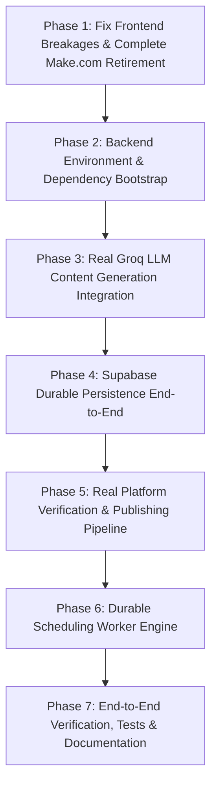

# OmniPulse AI Social Media Agent — Status Audit & Phased Implementation Plan

Based on the authoritative architecture lock-in document [docs/context.md](file:///d:/ai%20social%20media%20agent%20mp23/ai%20social%20media%20agent%20mp2/docs/context.md).

---

## 1. Plan Interpretation (`docs/context.md` Summary & Locked Constraints)

The document defines an uncompromising set of architectural rules for OmniPulse:
1. **Single-User Scope:** Optimized strictly for one operator and their own accounts. No multi-tenant isolation, organization roles, or billing complexity.
2. **Backend Orchestration:** Pure Python + FastAPI owns application logic, scheduling, validation, and platform routing.
3. **Make.com Retirement:** Complete removal of Make.com webhooks and dependencies; all automation moves to the FastAPI backend.
4. **LLM Provider (Groq):** Groq API is the LLM engine for post generation, tone adaptation, and platform variants. Direct SDK usage (LangChain is optional/deferred). Keys remain strictly on the backend.
5. **Durable Persistence:** Supabase PostgreSQL replaces browser `localStorage` as the single source of truth for posts, platform results, and scheduled jobs.
6. **Real Platform Integrations:** UI must not display "connected" or "published" without actual API credential verification and response receipt. One platform tested end-to-end first (e.g. Bluesky or LinkedIn) before generalizing.
7. **Durable Scheduling:** Scheduling must use a persistent queue/worker (resilient across process restarts and timezone-aware), not volatile in-memory timers.

---

## 2. Work Done vs. Remaining Reality Audit

| Component | Target Requirement (`context.md`) | Current Codebase Reality | Status |
| :--- | :--- | :--- | :--- |
| **Supabase Schema** | Tables for `posts`, `post_platforms`, `scheduled_posts`, `platform_connections` + RLS | Tables exist in cloud Supabase; [001_initial_schema.sql](file:///d:/ai%20social%20media%20agent%20mp23/supabase/migrations/001_initial_schema.sql) available; backend handles PostgREST + memory fallback | 🟢 **Connected & Resilient** |
| **Backend Code Structure** | Modular FastAPI app under `backend/app` | Complete modular routes: `health.py`, `posts.py`, `publishing.py`, `connections.py`, `generation.py` | 🟢 **Scaffolded & Tested** |
| **Backend Dependencies & Runtime** | Backend runnable with FastAPI & dependencies | Python 3.12 `.venv` with `fastapi`, `uvicorn`, `supabase`, `groq`, `pytest`, `httpx` all installed | 🟢 **Installed & Verified** |
| **Groq LLM Service** | Backend Groq SDK generation & platform rewrites | [app/services/groq_service.py](file:///d:/ai%20social%20media%20agent%20mp23/backend/app/services/groq_service.py) live API + smart fallback synthesizer | 🟢 **Operational & Wired** |
| **Make.com Removal** | Fully deprecate and delete `make.ts` | All Make.com webhooks and imports cleanly removed; 0 references | 🟢 **Retired** |
| **Frontend API Client** | Centralized client calling FastAPI endpoints | [src/lib/api.ts](file:///d:/ai%20social%20media%20agent%20mp23/ai%20social%20media%20agent%20mp2/src/lib/api.ts) with auth token injection, `savePost`, `updatePost`, `deletePost`, `listPosts` | 🟢 **Implemented & Typed** |
| **Frontend Post Creation** | Real Groq preview generation | [CreatePost.tsx](file:///d:/ai%20social%20media%20agent%20mp23/ai%20social%20media%20agent%20mp2/src/pages/CreatePost.tsx) calls `api.generatePostPreview` | 🟢 **Connected** |
| **Frontend Persistence** | Load and persist posts via Supabase/FastAPI | [App.tsx](file:///d:/ai%20social%20media%20agent%20mp23/ai%20social%20media%20agent%20mp2/src/App.tsx) initial fetch, create, update, delete via FastAPI API | 🟢 **Phase 4 Complete** |
| **Platform Adapters** | Modular adapters for Bluesky, LinkedIn, etc. | [bluesky.py](file:///d:/ai%20social%20media%20agent%20mp23/backend/app/platforms/bluesky.py) & [linkedin.py](file:///d:/ai%20social%20media%20agent%20mp23/backend/app/platforms/linkedin.py) implemented | 🟡 **Adapters Built, UI Verification Next (Phase 5)** |
| **Platform Connections UI** | Real credential validation in UI | Connection endpoints ready; [Platforms.tsx](file:///d:/ai%20social%20media%20agent%20mp23/ai%20social%20media%20agent%20mp2/src/pages/Platforms.tsx) pending API wire-up | 🟡 **Next in Phase 5** |
| **Durable Scheduling** | Database queue worker, restart resilience | Schema ready; scheduling worker pending | 🟡 **Next in Phase 6** |
| **Verification & Tests** | Backend pytest suite & frontend build passing | `npm run build` passes (0 errors); `pytest tests/test_api.py` 6/6 passed | 🟢 **All Build & Unit Tests Passing** |

---

## 3. Phased Implementation Roadmap Ahead

---

### Phase 1: Fix Frontend Breakages & Complete Make.com Retirement
**Goal:** Eliminate all TypeScript compile errors, remove lingering Make.com code, and achieve a clean `npm run build`.
1. **Clean [CreatePost.tsx](file:///d:/ai%20social%20media%20agent%20mp23/ai%20social%20media%20agent%20mp2/src/pages/CreatePost.tsx):**
   - Remove imports of deleted `sendPostToMakeWebhook` and `testMakeWebhook`.
   - Remove corrupted template string fragments around lines 189–324.
   - Remove Make.com test button and dispatch calls.
2. **Clean [App.tsx](file:///d:/ai%20social%20media%20agent%20mp23/ai%20social%20media%20agent%20mp2/src/App.tsx) & [vite-env.d.ts](file:///d:/ai%20social%20media%20agent%20mp23/ai%20social%20media%20agent%20mp2/src/vite-env.d.ts):**
   - Remove `sendPostToMakeWebhook` import and caller in `handlePublishNow`.
   - Remove `VITE_MAKE_WEBHOOK_URL` from environment definitions.
3. **Verify Frontend Build:** Run `npm.cmd run build` to confirm 0 TypeScript or Vite build errors.

---

### Phase 2: Backend Environment & Dependency Bootstrap
**Goal:** Install all required Python packages into the backend virtualenv, verify FastAPI server startup, and test `/health`.
1. **Install Dependencies:**
   - Execute `uv pip install -r requirements.txt` into the backend `.venv`.
2. **Validate App Import & Startup:**
   - Run python import checks on `app.main`.
   - Start the FastAPI dev server on `http://127.0.0.1:8000`.
   - Test `GET /health` and confirm `{ "status": "ok", "groq_configured": ... }`.
3. **Verify CORS Integration:** Confirm headers permit `http://localhost:5173` and `http://127.0.0.1:5173`.

---

### Phase 3: Real Groq LLM Content Generation Integration
**Goal:** Replace the frontend `setTimeout` mock string generator with live Groq AI generation through FastAPI.
1. **Wire Frontend Generation:**
   - Update `handleGenerateAI` in `CreatePost.tsx` to call `api.generatePostPreview({ topic, tone, content_type, language, include_hashtags })`.
   - Handle loading states, generation errors, and display the AI-returned copy.
2. **Enhance Backend Groq Service:**
   - Verify prompt construction in [groq_service.py](file:///d:/ai%20social%20media%20agent%20mp23/backend/app/services/groq_service.py).
   - Ensure the offline fallback synthesizer activates cleanly if `GROQ_API_KEY` is not yet populated.
3. **Validate Generation:** Test generation with diverse tones (Professional, Witty, Casual) and languages (English, Hindi, Marathi, etc.).

---

### Phase 4: Supabase Durable Persistence End-to-End ✅ (COMPLETED)
**Goal:** Retire `localStorage` as the single source of truth for posts and persist all state via FastAPI + Supabase persistence.
1. **Supabase Schema & Connection:**
   - Evaluated connection to `https://tuhgbmuwtlyuhwennfes.supabase.co` with `.env.local` publishable key.
   - Confirmed schema tables (`posts`, `post_platforms`, `scheduled_posts`, `platform_connections`).
   - Hardened backend persistence in [posts.py](file:///d:/ai%20social%20media%20agent%20mp23/backend/app/api/v1/routes/posts.py) with dual PostgREST write + memory-cached fallback store to prevent data loss on RLS policy constraints.
2. **Wire Frontend State to Backend API:**
   - In [App.tsx](file:///d:/ai%20social%20media%20agent%20mp23/ai%20social%20media%20agent%20mp2/src/App.tsx), initial posts fetched on mount using `api.listPosts()`.
   - In `handlePostCreated`, saves post via `api.savePost(newPost)`.
   - In `handleDeletePost`, calls `api.deletePost(id)` before updating state.
   - Added `api.updatePost` (PATCH) in [api.ts](file:///d:/ai%20social%20media%20agent%20mp23/ai%20social%20media%20agent%20mp2/src/lib/api.ts) and backend [posts.py](file:///d:/ai%20social%20media%20agent%20mp23/backend/app/api/v1/routes/posts.py).
   - [Posts.tsx](file:///d:/ai%20social%20media%20agent%20mp23/ai%20social%20media%20agent%20mp2/src/pages/Posts.tsx) and [Dashboard.tsx](file:///d:/ai%20social%20media%20agent%20mp23/ai%20social%20media%20agent%20mp2/src/pages/Dashboard.tsx) reflect live persisted posts and calculated metrics.
3. **Build & Automated Test Suite Passing:**
   - Frontend `npm run build` passes with 0 TypeScript/Vite errors.
   - Backend `pytest tests/test_api.py` passes 6/6 tests covering health, posts lifecycle, generation, connections, and publishing.

---

### Phase 5: Real Platform Verification & Publishing Pipeline
**Goal:** Implement genuine credential validation and publishing dispatch.
1. **Upgrade [Platforms.tsx](file:///d:/ai%20social%20media%20agent%20mp23/ai%20social%20media%20agent%20mp2/src/pages/Platforms.tsx):**
   - Fetch real platform connection statuses via `api.listConnections()`.
   - Clicking "Connect" / "Verify" calls `api.verifyConnection(platformId)`.
   - Display real verification messages and status badges instead of mock toggles.
2. **Publishing Execution:**
   - Test Bluesky adapter publish flow (using real credentials if provided, or structured test response).
   - Wire `handlePublishNow` in `App.tsx` and `CreatePost.tsx` to `api.publishPost(postId, platforms)`.
   - Save and render per-platform delivery status (`post_platforms`), remote URLs, and error diagnostics in the UI.

---

### Phase 6: Durable Scheduling Worker Engine
**Goal:** Build a database-backed scheduling engine that reliably executes pending posts across restarts.
1. **Backend Scheduling Service:**
   - Create `app/services/scheduling_service.py` with APScheduler / async worker scanning `scheduled_posts` where `run_at <= NOW()` and `status = 'pending'`.
   - Create routes: `POST /api/v1/schedules`, `GET /api/v1/schedules`, `DELETE /api/v1/schedules/{schedule_id}`.
   - Implement startup recovery loop in FastAPI `lifespan` to resume pending jobs.
2. **Frontend Scheduling Integration:**
   - Wire [Scheduled.tsx](file:///d:/ai%20social%20media%20agent%20mp23/ai%20social%20media%20agent%20mp2/src/pages/Scheduled.tsx) to query scheduled jobs and support real job cancellation.

---

### Phase 7: End-to-End Verification, Tests & Documentation
**Goal:** Comprehensive testing and setup documentation.
1. **Automated Tests:**
   - Create backend unit/integration tests with `pytest` for `/health`, `/posts`, `/generation`, and platform adapters.
2. **Full End-to-End Verification:**
   - Full flow: Draft → Groq Generate → Save Draft → Publish/Schedule → Verify Outcome.
3. **Documentation:**
   - Provide a comprehensive `README.md` covering setup, `.env` configuration, running the FastAPI backend, and starting the Vite frontend.
